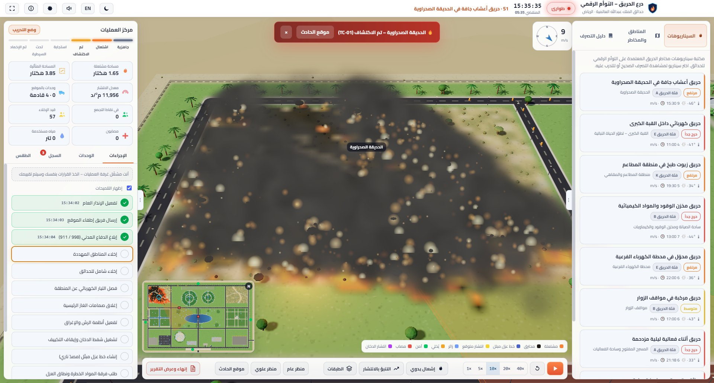
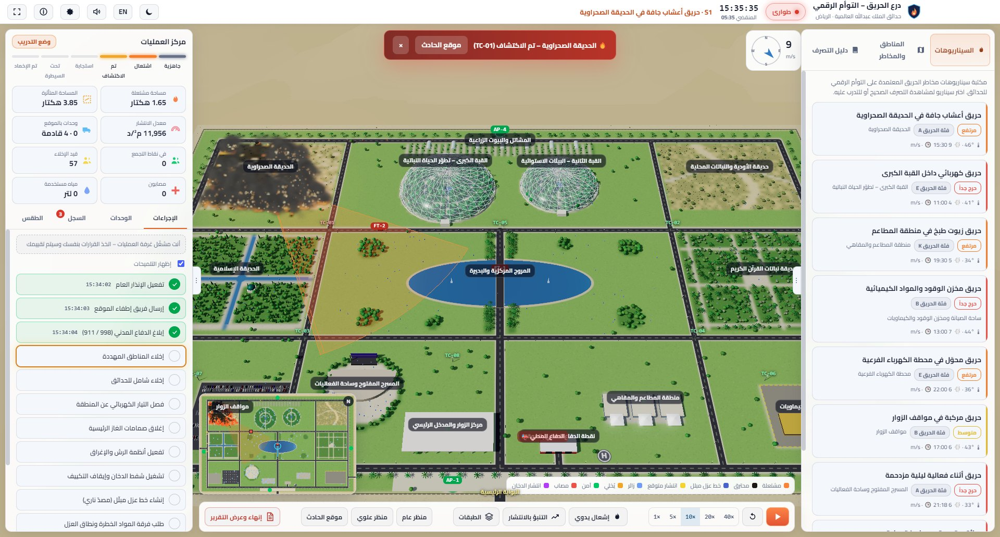

# درع الحريق — التوأم الرقمي لمحاكاة الحريق والاستجابة للطوارئ

**FireShield Twin – KAIG — Fire-Risk & Emergency-Response Digital Twin**

توأم رقمي ثلاثي الأبعاد لـ**حدائق الملك عبدالله العالمية** بالرياض لمحاكاة مخاطر الحريق والتدريب على الاستجابة للطوارئ. يحاكي انتشار الحريق حسب الرياح والرطوبة والحرارة، وإخلاء الزوار إلى نقاط التجمع، ووحدات الإطفاء والإسعاف على شبكة الطرق. يتضمن 8 سيناريوهات حريق جاهزة وسيناريو مخصصاً، وعرضاً تلقائياً للاستجابة الصحيحة، ووضع تدريب بتقييم من 100 مع تقرير PDF بعد كل سيناريو.

## ⬇️ التحميل

| الملف | الوصف |
|---|---|
| [**FireShield-Twin-KAIG-Setup-1.0.0.exe**](https://github.com/asfantrading-create/FireShield-Twin-KAIG/releases/latest/download/FireShield-Twin-KAIG-Setup-1.0.0.exe) | المثبّت (يُنشئ اختصاراً على سطح المكتب وقائمة ابدأ) |
| [**FireShield-Twin-KAIG-Portable-1.0.0.exe**](https://github.com/asfantrading-create/FireShield-Twin-KAIG/releases/latest/download/FireShield-Twin-KAIG-Portable-1.0.0.exe) | نسخة محمولة تعمل مباشرة بدون تثبيت |
| [**FireShield-Twin-KAIG-User-Guide-AR-EN.pdf**](https://github.com/asfantrading-create/FireShield-Twin-KAIG/releases/latest/download/FireShield-Twin-KAIG-User-Guide-AR-EN.pdf) | دليل المستخدم بالعربي والإنجليزي مع صور توضيحية |

صفحة كل الإصدارات: [Releases](https://github.com/asfantrading-create/FireShield-Twin-KAIG/releases)

## متطلبات التشغيل

- Windows 10 أو 11 (64-بت)
- ذاكرة 8 جيجابايت
- بطاقة رسوميات تدعم WebGL 2
- شاشة بدقة 1600×900 أو أعلى (يُفضّل 1920×1080)
- لا يحتاج إلى اتصال بالإنترنت

> **ملاحظة:** إذا ظهر تحذير Windows SmartScreen عند أول تشغيل، اختر «مزيد من المعلومات» ثم «تشغيل على أي حال».

---

## English

A 3D digital twin of **King Abdullah International Gardens**, Riyadh, for fire-risk simulation and emergency-response training. It simulates fire spread driven by wind, humidity and temperature, visitor evacuation to assembly points, and fire and ambulance units on the road network. It includes 8 ready-made fire scenarios plus a custom one, an auto demo of the correct response, and a training mode scored out of 100 with a PDF report after every scenario.

### Download

- [Installer — FireShield-Twin-KAIG-Setup-1.0.0.exe](https://github.com/asfantrading-create/FireShield-Twin-KAIG/releases/latest/download/FireShield-Twin-KAIG-Setup-1.0.0.exe)
- [Portable — FireShield-Twin-KAIG-Portable-1.0.0.exe](https://github.com/asfantrading-create/FireShield-Twin-KAIG/releases/latest/download/FireShield-Twin-KAIG-Portable-1.0.0.exe)
- [User guide (Arabic / English) — PDF](https://github.com/asfantrading-create/FireShield-Twin-KAIG/releases/latest/download/FireShield-Twin-KAIG-User-Guide-AR-EN.pdf)

**Requirements:** Windows 10/11 (64-bit), 8 GB RAM, a WebGL 2 graphics card, and a screen of 1600×900 or larger. No internet connection needed.

If Windows SmartScreen warns you on first launch, choose "More info" and then "Run anyway".

© 2026 ASFAN. All rights reserved.
